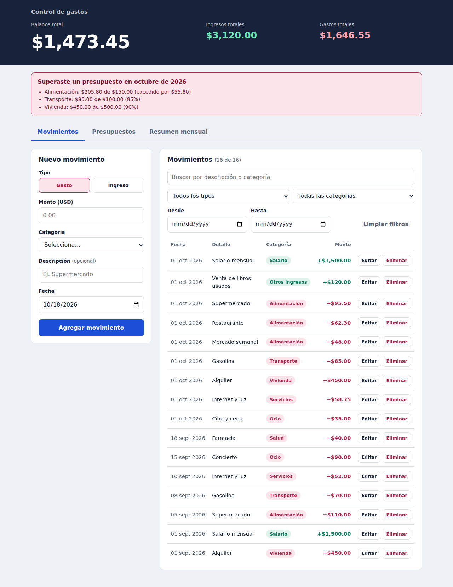
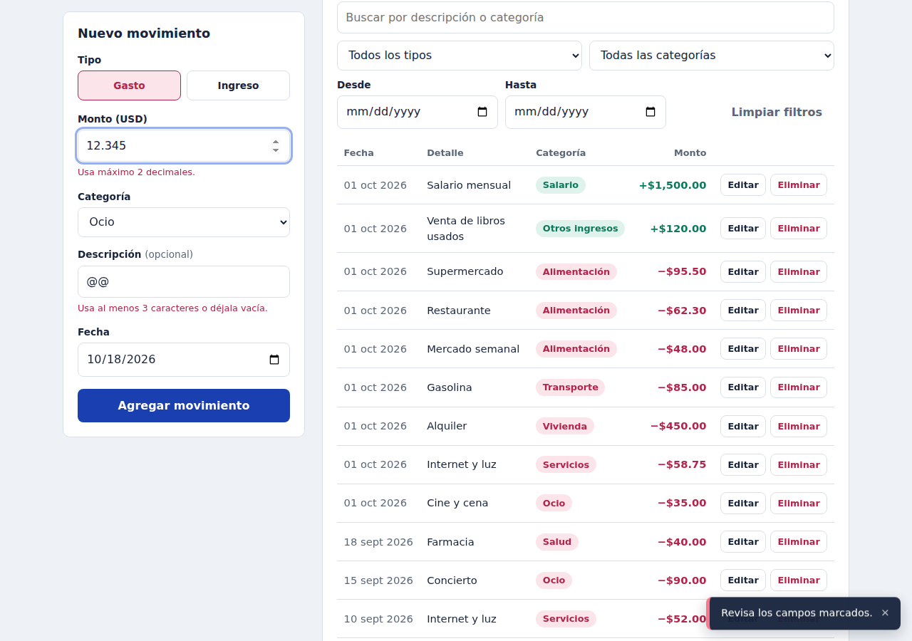
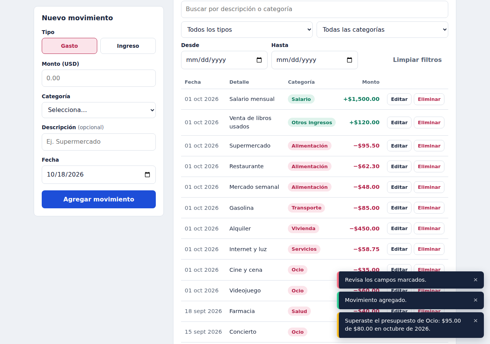
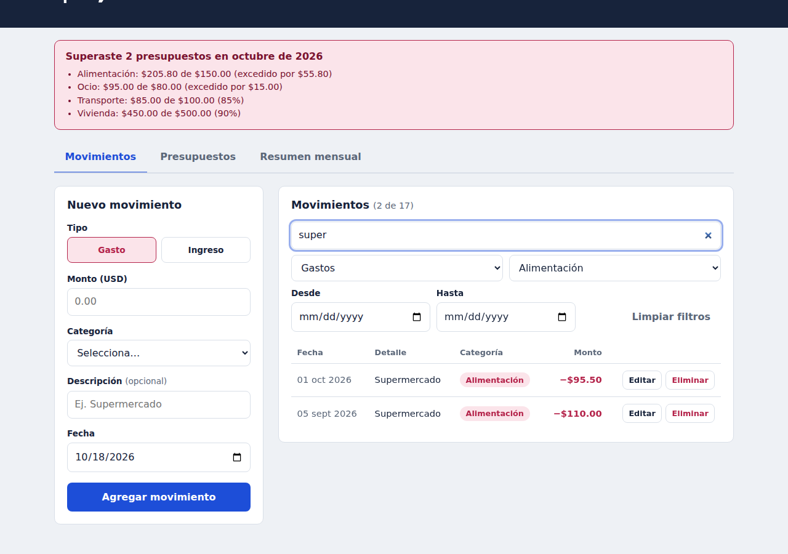
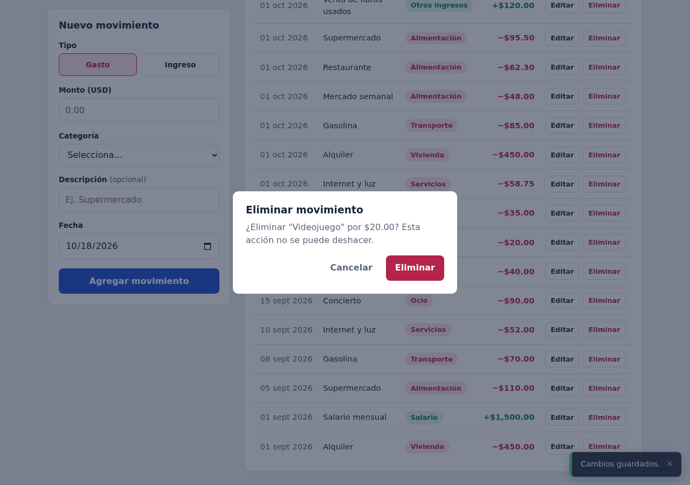
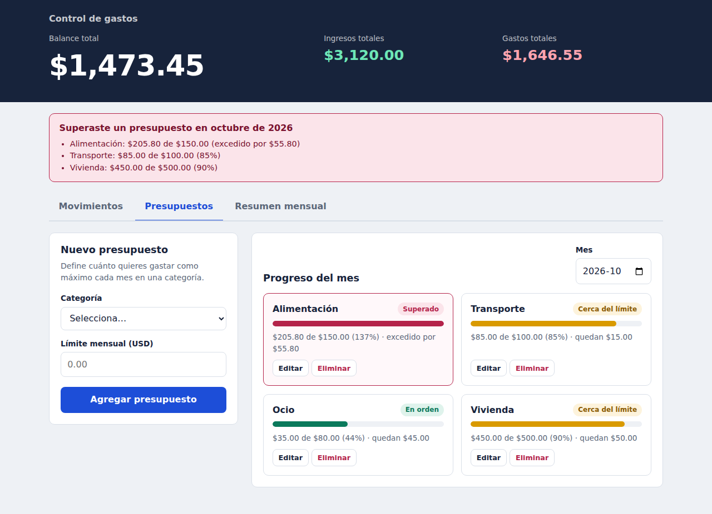
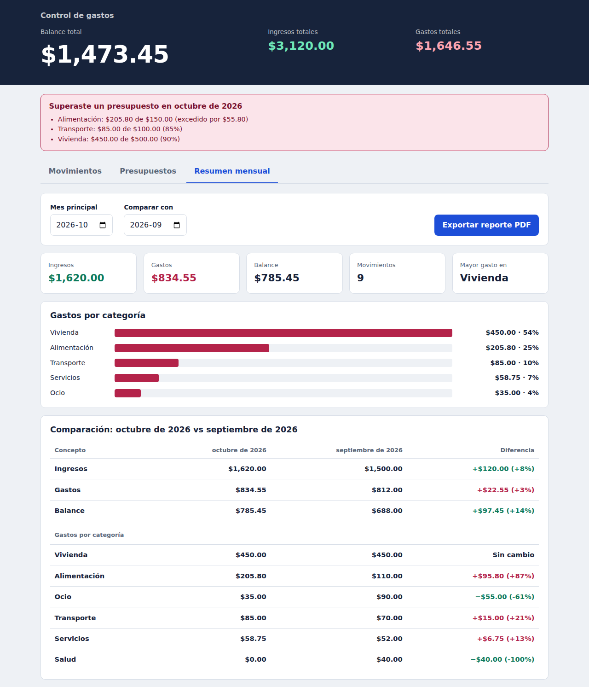
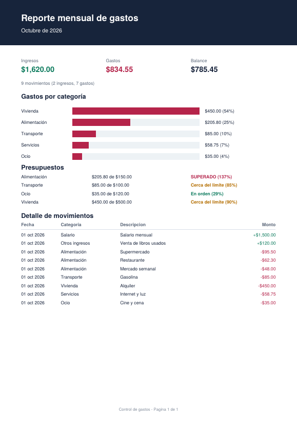
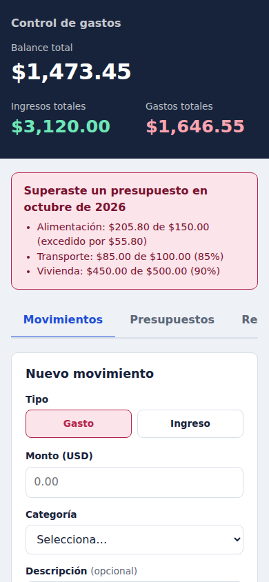

# 💰 Control de Gastos

Aplicación web para registrar ingresos y gastos personales, con **balance automático, presupuestos mensuales por categoría, alertas, resumen mensual, gráfico, comparación de meses y exportación a PDF**.

Desarrollada con **TypeScript** (sin frameworks) bajo arquitectura **MVC** y empaquetada con **Vite**. Esta versión corresponde a la actualización del Laboratorio #2 (Parcial 2).

## Cómo ejecutarlo

Requiere [Node.js](https://nodejs.org) 18 o superior.

```bash
npm install
npm run dev        # servidor de desarrollo → http://localhost:5173
npm run build      # revisa tipos (tsc) y genera la versión de producción en /dist
npm run preview    # sirve la versión de producción
```

> 📄 La explicación completa de mejoras y decisiones está en el [**Documento técnico**](docs/DOCUMENTO-TECNICO.md).

---

## Capturas de pantalla

### Movimientos: registro, lista, búsqueda y filtros


### Validaciones avanzadas con mensajes por campo


### Alerta inmediata al superar un presupuesto (RF-06)


### Búsqueda y filtros combinados: texto + tipo + categoría (+ rango de fechas)


### Eliminación con confirmación (RF-03)


### Presupuestos mensuales por categoría (RF-01)


### Resumen mensual, gráfico por categoría y comparación de dos meses (RF-07, RF-08, RF-09)


### Reporte mensual exportado a PDF (reto adicional)


### Diseño adaptable a móvil


---

## Funcionalidades

| Código | Requerimiento | Dónde verlo en la app |
|--------|---------------|-----------------------|
| **RF-01** | Presupuesto mensual por categoría | Pestaña *Presupuestos* (crear, editar, eliminar) |
| **RF-02** | Editar movimientos existentes | Botón *Editar* en cada fila |
| **RF-03** | Eliminar con confirmación | Botón *Eliminar* → diálogo de confirmación |
| **RF-04** | Filtrar por tipo, categoría y fecha | Panel de filtros (se combinan entre sí y con la búsqueda) |
| **RF-05** | Guardar en `localStorage` | Automático; los datos sobreviven a recargar |
| **RF-06** | Alerta al superar el presupuesto | Notificación al guardar un gasto + banner permanente del mes actual |
| **RF-07** | Resumen mensual | Pestaña *Resumen mensual* |
| **RF-08** | Gráfico de gastos por categoría | Pestaña *Resumen mensual* |
| **RF-09** | Comparar dos meses | Pestaña *Resumen mensual* (mes principal vs. mes a comparar) |
| **Reto** | Exportar reporte mensual a PDF | Botón *Exportar reporte PDF* |

Además: búsqueda por texto, contadores y estadísticas, notificaciones con cierre automático, validaciones de formato/duplicados/rangos y tres vistas en pestañas.


## Arquitectura MVC

```
src/
├── main.ts                          Composición: crea modelos, vistas y controladores
├── models/
│   ├── Movimiento.ts                Entidad + validaciones de formato y rangos
│   ├── Presupuesto.ts               Entidad (nueva)
│   ├── MovimientoModel.ts           Colección, CRUD, cálculos, filtros, checkPresupuesto()
│   ├── PresupuestoModel.ts          Colección de presupuestos y su CRUD
│   └── Observable.ts                Patrón Observer (los modelos avisan cambios)
├── views/
│   ├── MovimientoView.ts            Formulario, lista, filtros, renderBalance(), renderAlertaPresupuesto()
│   ├── PresupuestoView.ts           Formulario y tarjetas de progreso
│   ├── ResumenView.ts               Estadísticas, renderGrafico(), comparación de meses
│   └── ComponentesUI.ts             Notificaciones (toast), diálogo de confirmación, pestañas
├── controllers/
│   ├── MovimientoController.ts      handleCreate/Update/Delete/Filter + alertas
│   ├── PresupuestoController.ts     CRUD de presupuestos
│   └── ResumenController.ts         Resumen, comparación y exportación a PDF
├── services/
│   ├── StorageService.ts            Persistencia genérica en localStorage
│   └── ReporteService.ts            Generación del PDF (jsPDF, carga bajo demanda)
├── utils/formato.ts                 Moneda, fechas y utilidades de mes
└── styles/styles.css
```

**Regla de dependencias:** el *Modelo* no conoce el DOM; la *Vista* no contiene lógica de negocio (avisa por callbacks); el *Controlador* conecta ambos. Cuando un modelo cambia, notifica a sus suscriptores (Observer) y las vistas se redibujan solas.

## Persistencia

| Clave de `localStorage` | Contenido |
|-------------------------|-----------|
| `control-gastos:movimientos` | Arreglo de `MovimientoDTO` |
| `control-gastos:presupuestos` | Arreglo de `PresupuestoDTO` |

Los registros corruptos se descartan al cargar, y si el guardado falla (almacenamiento lleno o bloqueado) el estado en memoria no cambia y se informa al usuario.

## Verificación

El proyecto compila en modo `strict` sin errores (`npm run build`). El script opcional `scripts/e2e_capturas.py` ejecuta un recorrido completo en un navegador real (CRUD, validaciones, filtros, alertas, PDF, persistencia, vista móvil) y regenera las capturas:

```bash
pip install playwright && playwright install chromium
npm run build && npx vite preview --port 4173      # en una terminal
python3 scripts/e2e_capturas.py                    # en otra
```

## Estructura de archivos

```
control-gastos/
├── index.html
├── package.json
├── tsconfig.json
├── README.md
├── docs/
│   ├── DOCUMENTO-TECNICO.md
│   └── capturas/
├── scripts/e2e_capturas.py
└── src/ …
```
